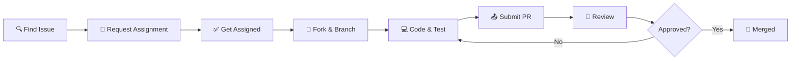
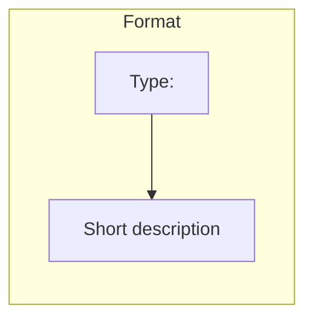
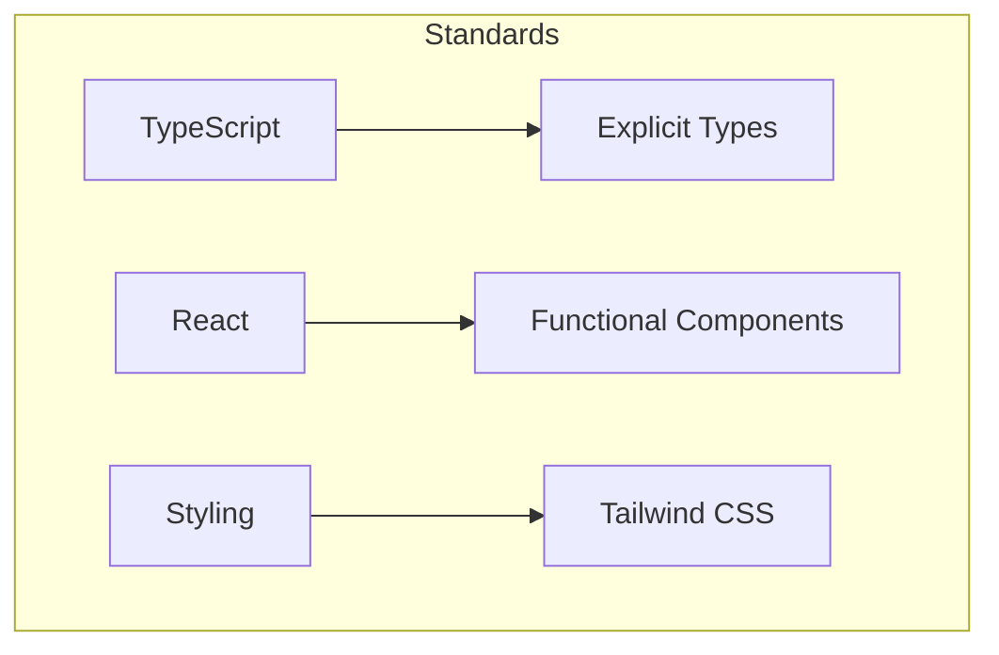

# Contributing to AnonChat 🤝

Thank you for your interest in contributing! This guide covers everything you need.

## 🔄 Contribution Workflow



## 🚀 Quick Start

```bash
# 1. Fork repo on GitHub, then clone
git clone https://github.com/your-username/AnonChat.git
cd AnonChat

# 2. Add upstream & create branch
git remote add upstream https://github.com/original-owner/AnonChat.git
git checkout -b fix-[issue-number]

# 3. Install dependencies and setup pre-commit hooks
npm install
npx husky install

# 4. Make your changes
# Your changes will be automatically checked before committing

# 3. Install & develop
pnpm install
pnpm dev

# 4. Test, commit & push
pnpm lint && pnpm build
git commit -m "Fix: description (#issue-number)"
git push origin fix-[issue-number]
```

## 🌲 Branch Naming

| Type | Format | Example |
|------|--------|---------|
| Bug fix | `fix-{issue}` | `fix-123` |
| Feature | `feature-{issue}` | `feature-456` |
| Docs | `docs-{issue}` | `docs-789` |

## 💬 Commit Messages



**Types:** `Fix:` `Feat:` `Docs:` `Refactor:` `Test:` `Chore:`

```bash
# ✅ Good
git commit -m "Fix: Resolve chat message duplication (#123)"

# ❌ Bad
git commit -m "fixed stuff"
```

## 📝 Pull Request

### PR Checklist

- [ ] Branch from latest `main`
- [ ] `pnpm lint` passes
- [ ] `pnpm build` succeeds
- [ ] Tested locally
- [ ] PR description includes `Closes #issue-number`

### PR Template

```markdown
## Summary
Brief description (1-2 sentences)

## Changes
- Change 1
- Change 2

Closes #[issue-number]
```

## 🪝 Pre-Commit Hooks

This project uses **Husky** to automatically check code before committing.

### What Gets Checked?
- ✅ TypeScript types - No type errors allowed
- ✅ ESLint - Code style and best practices
- ✅ Staged files only - Only your changes are checked

### Setup (Do this once)

```bash
npm install
npx husky install
```

### How It Works

When you commit:
```bash
git commit -m "Fix: something"
```

The hooks automatically:
1. Check TypeScript types
2. Run ESLint on your files
3. Prevent commit if errors found

### Fixing Errors

**TypeScript error?**
```bash
npx tsc --noEmit   # See errors
# Fix them, then:
git add .
git commit -m "..."
```

**ESLint error?**
```bash
npx eslint . --fix  # Auto-fix issues
git add .
git commit -m "..."
```

### Skip Hooks (Last Resort)

```bash
git commit --no-verify
```

⚠️ Use sparingly! Hooks exist to maintain code quality.

For more details, see [PRE_COMMIT_HOOKS.md](PRE_COMMIT_HOOKS.md)

## 📋 Code Standards



**Key Rules:**
- Use TypeScript with explicit types (avoid `any`)
- Functional components with hooks
- Tailwind CSS for styling
- Follow existing patterns in codebase

## ⚠️ Important Rules

| ✅ Do | ❌ Don't |
|-------|----------|
| Wait for assignment | Start without assignment |
| One issue per PR | Mix unrelated changes |
| Test thoroughly | Skip testing |
| Respond to feedback promptly | Ignore review comments |
| Complete within 3 days | Leave PR stale |

## 🧪 Testing Checklist

Before submitting:
- [ ] Feature works as intended
- [ ] No console errors
- [ ] Responsive design verified
- [ ] No visual regressions

## 📞 Need Help?

- Comment on the issue for questions
- Tag a maintainer for clarification

---

Thank you for contributing! 🌟
